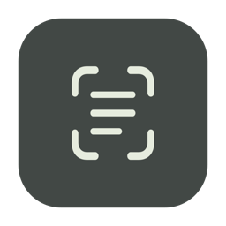
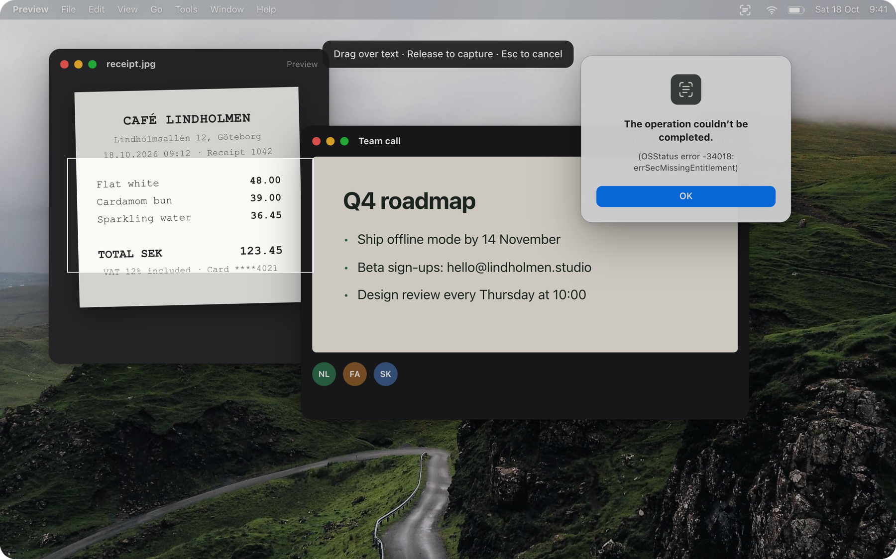
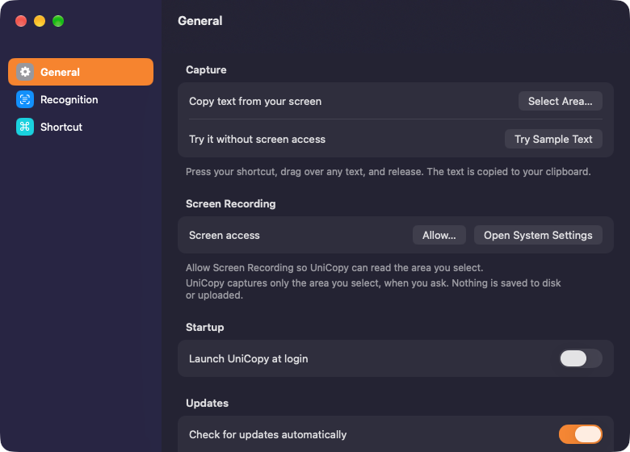
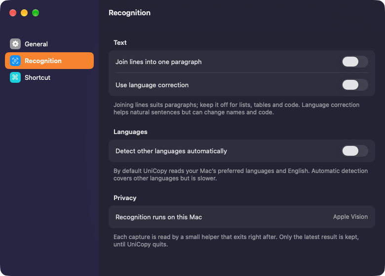
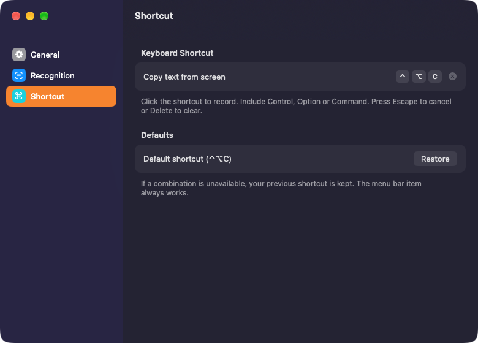

<p align="center">
  
</p>

<h1 align="center">UniCopy</h1>

<p align="center">
  <b>Copy text from anywhere on your screen.</b><br>
  A free menu bar app for your Mac. Select an area, and its text is on your clipboard, recognised on your Mac.
</p>

<p align="center">
  <a href="https://github.com/musaAmir/UniCopy/releases"><b>Download</b></a> ·
  <a href="https://musaamir.github.io/UniCopy/"><b>Website</b></a> ·
  macOS 14+ · Apple silicon &amp; Intel
</p>

<p align="center">
  
</p>

<p align="center"><sub>Try it live on the <a href="https://musaamir.github.io/UniCopy/">website</a>: press ⌃⌥C and drag over any text.</sub></p>

## Features

- **Copy what you can see.** Press <kbd>⌃</kbd> <kbd>⌥</kbd> <kbd>C</kbd>, drag over text in an image, video, slide or error message, and release. Escape cancels.
- **On-device recognition.** Apple Vision reads the text on your Mac. Nothing is uploaded and no screenshot is saved.
- **Reads it the way you need it.** Join lines into a paragraph, use language correction for prose, or detect other languages automatically. Hold <kbd>⇧</kbd> as you release to flip line joining for one capture.
- **QR codes and barcodes too.** Select a code and its link or value is copied, above any text around it.
- **Your shortcut.** Record any combination, or use the menu bar icon.
- **Never overwrites newer copies.** If you copy something else while recognition runs, your clipboard is kept and the editable result opens instead.
- **Stays out of the way.** Lives in the menu bar, launches at login if you want, and updates itself from GitHub releases.

## Settings

<table>
  <tr>
    <td></td>
    <td></td>
    <td></td>
  </tr>
</table>

## Install

1. Download the ZIP from [Releases](https://github.com/musaAmir/UniCopy/releases), unzip it and move **UniCopy.app** to **Applications**.
2. Open UniCopy. It isn’t notarized by Apple yet, so the first time macOS asks you to choose **Open Anyway** in **System Settings → Privacy & Security**.
3. Allow UniCopy under **System Settings → Privacy & Security → Screen Recording**. macOS may ask you to reopen the app.

**Try Sample Text** in the menu works without screen access. UniCopy captures only the area you select, when you release. Each capture is read by a helper process that exits right after, and only the latest result is kept until UniCopy quits. Select within one display per capture; very large areas are limited to 4096 pixels per edge.

## Build

Requires Xcode with Swift 5.9 or newer.

```sh
swift test
./build.sh universal
build/UniCopy.app/Contents/MacOS/UniCopy --test-worker   # checks the packaged OCR helper
```

[Releases and signing](docs/release.md) · [Recognition notes](docs/recognition.md) · [Website source](website/unicopy)
